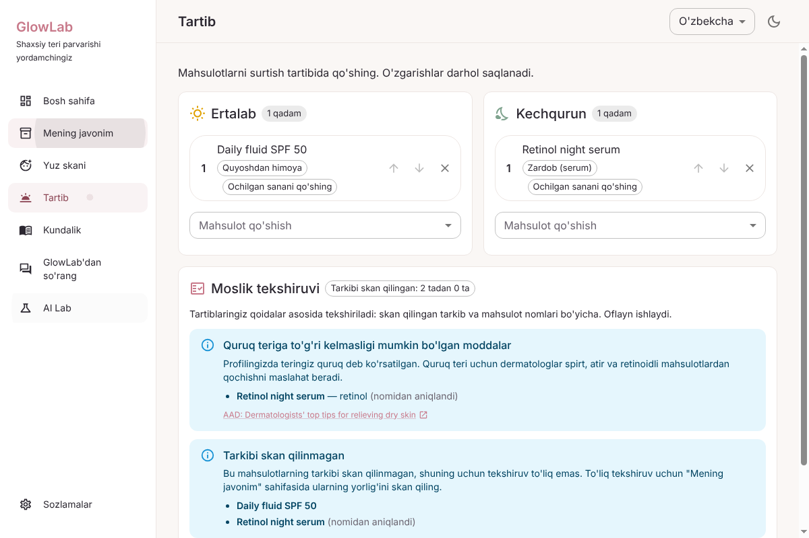
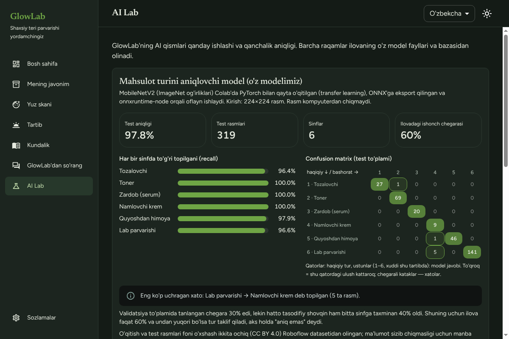
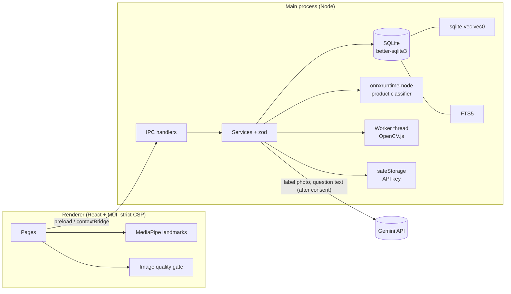

# GlowLab

**An offline-first skincare desktop app with on-device computer vision, a custom-trained image classifier and a grounded RAG assistant.**

Electron · React · TypeScript · SQLite · PyTorch → ONNX · MediaPipe · OpenCV.js · sqlite-vec · Gemini

> GlowLab is a portfolio project. It is **not a medical device**: every AI result in the app says "AI can make mistakes / not a diagnosis", and serious, painful or changing skin problems should go to a dermatologist.

| Routine + compatibility check                  | AI Lab (dark)                               |
| ---------------------------------------------- | ------------------------------------------- |
|  |  |

## Features

| Area                 | What it does                                                                                                                                                   | AI / technique                                                                                                       |
| -------------------- | -------------------------------------------------------------------------------------------------------------------------------------------------------------- | -------------------------------------------------------------------------------------------------------------------- |
| **My shelf**         | Products with opened date + PAO → expiry, "soon / expired" badges, macOS reminders                                                                             | Date math, zod validation                                                                                            |
| **Label scan**       | Photo of the ingredient list → ingredients, risk notes, profile-aware warnings                                                                                 | Gemini vision + JSON schema + zod; image quality gate first                                                          |
| **Photo suggestion** | Suggests the product type from a photo, fully offline                                                                                                          | **Own model:** MobileNetV2 transfer learning (PyTorch, Colab) → ONNX → onnxruntime-node                              |
| **Face scan**        | 6 visible-skin indicators from a photo or the camera, photo never saved                                                                                        | MediaPipe Face Landmarker (478 points) + OpenCV.js in a worker thread; thresholds shifted by skin type and age range |
| **Routine**          | Morning / evening routine + **compatibility check** (retinoid in the morning, acids without sunscreen, strong actives stacked, dry / sensitive skin conflicts) | Deliberately rule-based, each rule cites an AAD / FDA page                                                           |
| **Skin diary**       | Notes, feeling, tags, linked face scans, trend charts                                                                                                          | Hand-written SVG small multiples                                                                                     |
| **Ask GlowLab**      | Answers skincare questions **only** from a curated knowledge base, with [n] citations                                                                          | RAG: on-device `multilingual-e5-base` embeddings (ONNX) + **sqlite-vec** cosine search + grounded Gemini generation  |
| **AI Lab**           | Shows the real model numbers: test accuracy, per-class recall, confusion matrix, Grad-CAM, RAG status                                                          | Reads `metrics.json` written by the evaluation notebook                                                              |

UI languages: Uzbek, Korean, English. Light and dark theme.

## Architecture



- **ipc → service → model** layering; every renderer input is validated with zod in the main process.
- The renderer never touches Node, the database or the API key. The key is encrypted with Electron `safeStorage` and never sent back to the UI.
- OpenCV.js runs in a main-process worker so the renderer CSP only needs `'wasm-unsafe-eval'` (no `'unsafe-eval'`).
- SQLite schema changes are versioned migrations (`PRAGMA user_version`).

## The AI parts in more detail

### Product classifier (own model)

- Data: two public CC BY 4.0 Roboflow detection datasets, merged by a class map, boxes cropped to classification images, augmented copies skipped, deduplicated by hash, **split by source photo** to avoid leakage (`ml/01_dataset.ipynb`).
- Model: MobileNetV2 (ImageNet weights), frozen backbone + new head, then fine-tuning of the last blocks; class weights for imbalance (`ml/02_train.ipynb`).
- Result on 319 test images: **97.8 % accuracy**; most common mistake: lip care → moisturizer (5 images) (`ml/03_evaluate.ipynb`).
- In the app the confidence threshold is **0.60**, not the 0.30 chosen on validation, because random noise reached ~40 % for one class. Below 0.60 the app says "not sure".
- Honest limits: test images come from the same two datasets with similar backgrounds, so real photos will score lower. A Grad-CAM review found a non-cosmetic image labelled "serum" in the test set, so the serum class needs cleaning before its 100 % recall can be trusted.

### Face analysis

MediaPipe finds the face → a quality gate rejects no face / several faces / small or turned face / blur / bad light and asks for a better photo instead of guessing → OpenCV measures shine, redness, texture, dark spots, under-eye darkness and uneven tone in landmark-anchored regions. These are heuristics, not clinically validated. Only numbers are stored.

### RAG assistant

26 curated English passages from 18 AAD, FDA and Skin Cancer Foundation pages (`resources/kb/kb.json`) are embedded **on the computer** with `intfloat/multilingual-e5-base` (ONNX int8, 768 dims, mean pooling + L2 normalisation, run with the same `onnxruntime-node` as the classifier; tokenizer: `@huggingface/tokenizers`) into a `vec0` table. Questions in Uzbek, Korean or English are embedded the same way, so search works offline and without an API key; the question is not sent anywhere for retrieval.

Because e5 distances are tightly packed (even nonsense like "zzzz" lands ~0.25 from every passage), a question counts as covered only if its closest passage is clearly closer than the median passage (margin ≥ 0.023, `src/main/ai/relevance.ts`); passages farther than 0.35 are never used. With a key, Gemini must answer only from the top 4 passages with [n] citations, and answers without a valid citation are rejected as "not in the knowledge base". Without a key, the closest passages are shown instead. Only the question text is sent to Google, after consent, and only to write the answer.

Model choice was measured with `scripts/eval-embeddings.mjs` (24 questions in en/uz/ko + 6 unrelated):

| Model                              | Size   | Top-1     | Top-4     | Unrelated rejected (margin filter) |
| ---------------------------------- | ------ | --------- | --------- | ---------------------------------- |
| multilingual-e5-small              | 118 MB | 16/24     | 21/24     | —                                  |
| **multilingual-e5-base**           | 279 MB | **17/24** | **21/24** | 4/6 (8/10 with nonsense queries)   |
| paraphrase-multilingual-MiniLM-L12 | 118 MB | 15/24     | 16/24     | —                                  |

English questions: 8/8 top-1 for all models; Uzbek and Korean are harder (e5-base top-4: 7/8 and 6/8). The model file is too large for GitHub, so `yarn fetch:models` downloads it (pinned revision, SHA-256 checked).

## Privacy

- Everything is stored locally in `~/Library/Application Support/GlowLab/glowlab.db`.
- Face photos are analysed in memory and never saved or uploaded.
- Only two things can leave the computer, both after the user adds their own Gemini key and gives consent: a label photo (label scan) and a question's text (Ask GlowLab).

## Getting started

Requirements: macOS (Apple silicon), Node.js 22+, Yarn.

```bash
yarn install
yarn fetch:models   # RAG embedding model (279 MB, not in git)
yarn dev
```

Optional: add a Gemini API key in **Settings**, or for development create `.env` with `GEMINI_API_KEY=...` (never commit it).

## Testing

| Command          | What it runs                                                                                                                                                                                                                                                                        |
| ---------------- | ----------------------------------------------------------------------------------------------------------------------------------------------------------------------------------------------------------------------------------------------------------------------------------- |
| `yarn typecheck` | TypeScript (main, preload, shared, renderer, tests)                                                                                                                                                                                                                                 |
| `yarn lint`      | ESLint + Prettier                                                                                                                                                                                                                                                                   |
| `yarn test`      | Vitest unit tests (pure logic: dates, vector math, FTS query, compatibility rules, embedding pooling, relevance filter)                                                                                                                                                             |
| `yarn test:db`   | Vitest service tests on an in-memory SQLite + sqlite-vec, run inside Electron's Node (same native ABI as the app)                                                                                                                                                                   |
| `yarn test:e2e`  | Playwright launches the **real Electron app** on a temporary profile (no real data, no API key): onboarding → every page without console errors → add products → routine compatibility warnings appear and disappear → offline Ask → AI Lab numbers → screenshots in light and dark |

Gemini is never called in tests (a fake generator is injected). `yarn test:db` also runs the real e5 model on en/uz/ko questions when `yarn fetch:models` has been run (skipped otherwise).

## Build

```bash
yarn build:mac   # → dist/glowlab-1.0.0.dmg (not notarised)
```

The mac build keeps only the darwin onnxruntime binaries; `sqlite-vec`, onnxruntime and `resources/` are unpacked from the asar so native libraries and models load.

## Project structure

```
src/main       Electron main: ipc/, services/, models/, db/ (migrations), ai/ (Gemini, ONNX, OpenCV worker, RAG, rules)
src/preload    contextBridge API (typed)
src/renderer   React UI: pages/, components/, cv/ (MediaPipe), i18n/ (uz, ko, en)
src/shared     Types and pure logic shared by main and renderer
resources      models/ (ONNX, MediaPipe task, metrics), kb/ (knowledge base)
ml             Colab notebooks: dataset → train → evaluate → export
e2e            Playwright tests for the Electron app
```

## Data and model credits

- Product images (CC BY 4.0, Roboflow Universe): [skincare-dataset](https://universe.roboflow.com/visioncomputer/skincare-dataset) by `visioncomputer` and [makeup-products-detection](https://universe.roboflow.com/first-work-nnlbg/makeup-products-detection) by `first-work-nnlbg`.
- Face landmarks: Google MediaPipe Face Landmarker model.
- Text embeddings: [intfloat/multilingual-e5-base](https://huggingface.co/intfloat/multilingual-e5-base) (MIT), ONNX int8 export by [Xenova](https://huggingface.co/Xenova/multilingual-e5-base); tokenizer [@huggingface/tokenizers](https://github.com/huggingface/tokenizers.js).
- Knowledge base: short paraphrases of public pages by the American Academy of Dermatology, U.S. FDA and the Skin Cancer Foundation; every passage links to its source.

## Author

Bakhriddinov Alisher — [github.com/Alisherbakh](https://github.com/Alisherbakh)
